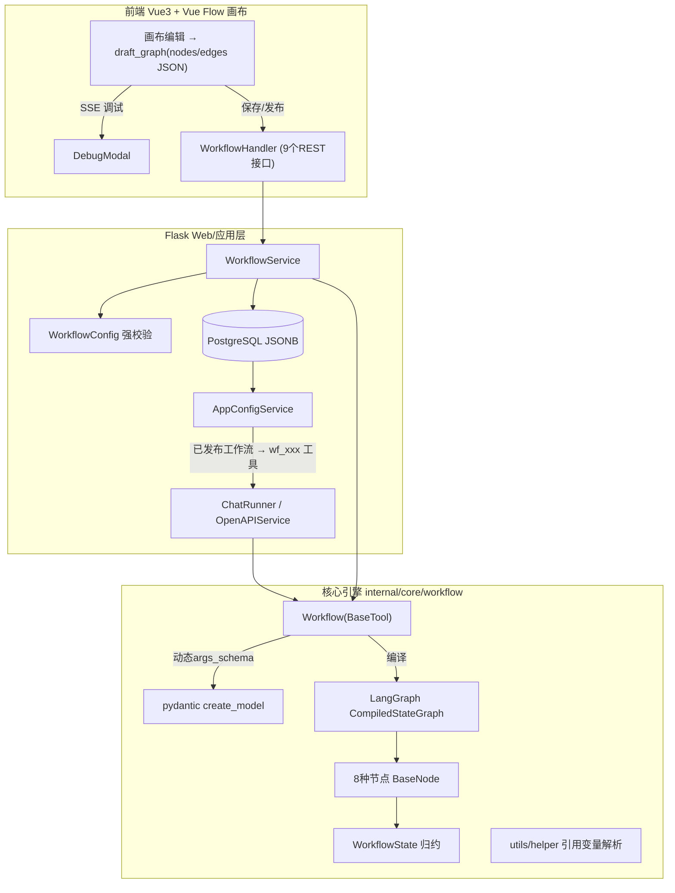

# 工作流引擎架构分析

> [!abstract] 摘要
> 这是一个 **Dify 风格的可视化工作流引擎**：把"工作流"整体封装成一个 LangChain `BaseTool`，底层用 **LangGraph StateGraph** 执行，从而让 Agent 像调用普通工具一样调用工作流。

> 关联代码：`internal/core/workflow/`（核心引擎）、`internal/service/workflow_service.py`（服务层）、`internal/router/router.py`（路由）、`ai-code-llmops-web/src/views/space/workflows/`（前端画布）
> 相关笔记：[[Agent记忆系统分层设计]]

## 总体架构



## 代码位置清单

| 层 | 文件 | 职责 |
|---|---|---|
| 核心引擎 | `internal/core/workflow/workflow.py` | `Workflow(BaseTool)`：动态入参 schema + 编译 LangGraph |
| 核心实体 | `internal/core/workflow/entities/` | `workflow_entity.py`（WorkflowConfig 强校验 + WorkflowState）、`node_entity.py`、`edge_entity.py`、`variable_entity.py` |
| 节点 | `internal/core/workflow/nodes/<type>/` | 8 种节点，每类 `*_entity.py`（数据/校验）+ `*_node.py`（执行逻辑） |
| 工具 | `internal/core/workflow/utils/helper.py` | 从 state 解析节点引用变量 |
| 应用层 | `internal/handler/workflow_handler.py` | 9 个 REST 接口（Flask + login_required） |
| 服务层 | `internal/service/workflow_service.py` | CRUD、草稿宽松校验、SSE 调试、发布 |
| Agent 集成 | `internal/service/app_config_service.py` | 把已发布工作流构建为 `wf_xxx` 工具 |
| 数据模型 | `internal/model/workflow.py` | `Workflow`、`WorkflowResult` 表 |
| 状态枚举 | `internal/entity/workflow_entity.py` | `WorkflowStatus`(draft/published)、`WorkflowResultStatus` |
| 请求/响应 | `internal/schema/workflow_schema.py` | FlaskForm 请求校验 + marshmallow 响应 |
| 前端 | `ai-code-llmops-web/src/{models,services,hooks}/workflow.*` + `views/space/workflows/` | 类型、API、composables、画布 UI |

## 核心引擎设计

### Workflow —— 一个"图引擎化的 LangChain 工具"

`Workflow(BaseTool)` 构造时做两件事：

1. **动态构建入参 schema**（`_build_args_schema`）：扫描 START 节点 `inputs`，用 pydantic `create_model` 按变量类型（string/int/float/boolean）动态生成工具参数，`required` 决定必填/选填。LLM 因此能看到工作流需要哪些参数。
2. **编译 LangGraph**（`_build_workflow`）：nodes/edges → `StateGraph(WorkflowState)`：
   - 节点以 `"{node_type}_{node_id}"` 注册（映射表 `NodeClasses`；DATASET_RETRIEVAL 额外注入 `flask_app` + `account_id`）；
   - `parallel_edges` 把"多前驱 → 同一目标"合并为并行边（LangGraph waiting edge：等待所有前驱完成）；
   - `graph.compile()`。

执行入口：
- `_run()` → `self._workflow.invoke({"inputs": kwargs})`，返回 `outputs`（Agent 调用时的结果）；
- `stream()` → 逐节点流式输出（调试用）。

### WorkflowConfig —— 图结构强校验

`model_validator(mode="before")` 完成整图校验：

- 名称只允许 `^[A-Za-z_][A-Za-z0-9_]*$`（英文，因用作工具名），描述 ≤ 1024 字；
- 节点按 `node_type` 反序列化为对应 `*NodeData`；节点 id/title 唯一；START/END 各且仅一个；
- 边引用节点必须存在、类型一致、不重复；
- **连通性**：邻接表 + BFS 从 START 出发，无孤立节点；
- **无环**：Kahn 拓扑排序；
- **引用校验**：逆邻接表 DFS 取全部前驱，REF 变量必须引用前驱节点且变量名存在。

### WorkflowState —— 状态归约

`WorkflowState(TypedDict)` 三个通道：

- `inputs` / `outputs`：`Annotated[dict, _process_dict]`（`{**left, **right}` 合并，后写覆盖）；
- `node_results`：`Annotated[list[NodeResult], _process_node_results]`（**列表拼接——跨节点传值的核心通道**，下游按引用从累积结果中取数）。

### 节点体系（插件式双文件结构）

每个节点一个目录：`*_entity.py`（pydantic 数据模型+校验）+ `*_node.py`（继承 `BaseNode(RunnableSerializable, ABC)`，实现 `invoke(state, config)` 返回 state 增量）。

| 节点 | 实体要点 | 执行逻辑 |
|---|---|---|
| start | 输入变量列表 | 从 `state["inputs"]` 取参、必填校验、补默认值 |
| llm | prompt + model_config | Jinja2 渲染 prompt → `LanguageModelService` 加载 LLM → 流式生成 |
| template_transform | jinja2 模板 | 变量合成为字符串 |
| dataset_retrieval | dataset_ids + retrieval_config | 构造时经 `RetrievalService` 预建检索工具，invoke 时调用 |
| code | 用户 Python 代码 | AST 校验（只允许 `def main(params)`）后 `exec` 执行 |
| tool | builtin/api 工具 | 内置走 `BuiltinProviderManager`，API 工具查 `ApiTool` 后构建 |
| http_request | url/method + params/headers/body | `requests` 调用，按 status_code 判定成败 |
| end | 输出变量列表 | 解析引用变量写入 `outputs` |

变量体系：`VariableEntity.value.type` 区分 `REF`（引用上游输出）/ `LITERAL`（直接输入）/ `GENERATED`（节点自身输出）。`helper.extract_variables_from_state` 遍历 `state["node_results"]` 按 `ref_node_id` 找上游输出并类型强转——这是引擎的"数据连线"机制。

## 执行链路

### 调试（SSE 流式）

`POST /workflows/<id>/debug` → `WorkflowService.debug_workflow`：

1. 用 `draft_graph` 构建 `WorkflowTool`，先建 `WorkflowResult`（RUNNING）；
2. `workflow_tool.stream(inputs)` 逐节点产出 chunk，每步取 `node_results[0]` 序列化为 SSE `event: workflow` 推送；
3. 结束置 SUCCEEDED/FAILED + 保存全量 node_results，置 `is_debug_passed=True`；
4. 出错时从 LangGraph traceback 用正则 `During task with name '...'` 反查出错节点 id/title，推送 `event: error`。

### 发布

`POST /workflows/<id>/publish`：要求 `is_debug_passed=True` → `WorkflowConfig` 二次强校验（失败则重置调试标志）→ `draft_graph` 快照到 `graph`，状态置 PUBLISHED。取消发布则清空 `graph` 回 DRAFT。

### 被 Agent 调用（工具化）

`AppConfigService.get_langchain_tools_by_workflow_ids` 查 `status=PUBLISHED` 的工作流，每个构建为一个 `Workflow` 工具（工具名前缀 `wf_`）。`ChatRunner`（对话）与 `OpenAPIService`（开放 API）把关联工作流追加进 tools 列表交给 `FunctionCallAgent`/`ReACTAgent`。LLM 决定调用时 → `_run(kwargs)` → 整图执行 → 返回 `outputs`。

## 数据模型与状态机

- `Workflow`：`graph`（已发布快照，JSONB）与 `draft_graph`（可编辑草稿，JSONB）分离，`is_debug_passed`、`status`、`published_at`；
- `WorkflowResult`：每次调试的运行时快照（graph + state + latency + 状态）；
- 状态机：`DRAFT ⇄ PUBLISHED`（发布需调试通过；取消发布回 DRAFT）。

## API 一览

| 方法 | 路径 | 说明 |
|---|---|---|
| GET/POST | `/workflows` | 分页列表 / 新建 |
| GET/POST | `/workflows/<id>` | 详情 / 更新基础信息 |
| POST | `/workflows/<id>/delete` | 删除 |
| GET/POST | `/workflows/<id>/draft_graph` | 读取 / 保存草稿图 |
| POST | `/workflows/<id>/debug` | SSE 调试运行 |
| POST | `/workflows/<id>/publish` `/cancel_publish` | 发布 / 取消发布 |

## 前端架构

- `models/workflow.ts`：请求/响应类型 + 草稿图结构；
- `services/workflow.ts`：REST 封装 + `debugWorkflow` 走 SSE 工具，按 `event` 分发 data/error；
- `hooks/use-workflow.ts`：10 个 composables（列表分页、CRUD、草稿图转换、调试）；
- `views/space/workflows/`：
  - `DetailView.vue`（1809 行画布主页面）：@vue-flow/core + dagre 自动布局、撤销/重做历史栈、复制/粘贴（start/end 不可复制）、右键菜单、拖拽加节点、节点错误高亮、调试 Modal；
  - `components/nodes/*.vue`：8 种画布节点组件；
  - `components/infos/*.vue`：每种节点的配置面板（含公共 `ModelConfig.vue`）；
  - `DebugModal.vue`：按 SSE 事件累积 node_results 展示节点状态/耗时/输出；
- App 集成：`WorkflowAbilityItem.vue` 让应用关联已发布工作流。

## 值得注意的设计点与风险

**设计亮点**
- 草稿宽松校验（`_validate_graph`，坏节点静默剔除）与发布/调试强校验（`WorkflowConfig`）双层校验；
- 图算法保证合法 DAG（BFS 连通性、Kahn 无环、逆邻接表引用校验）；
- `graph`/`draft_graph` 快照分离 + `WorkflowResult` 运行留痕。

> [!warning] 疑似 bug：workflow.py 174-175 行
> ```python
> graph.set_entry_point(start_node)
> graph.set_entry_point(end_node)   # ← 应为 set_finish_point(end_node)
> ```
> 已核对 langgraph 1.2.11 源码：`set_entry_point(k)` 等价于 `add_edge(START, k)`，两次调用是**叠加**而非覆盖。结果 START 同时连到开始节点和结束节点：END 会在图启动时立即执行一次（`node_results` 为空，引用变量全部解析为默认值），链条走完后又执行一次。调试流里 END 出现两次且第一次输出为空值。

> [!danger] Code 节点无沙箱
> `code_node.py` 直接 `exec()` 执行用户代码（代码内 TODO 自认"非常危险"），属于远程代码执行面，应迁移到隔离沙箱/容器。

**其他风险**
- 宽松校验静默丢数据：`_validate_graph` 对坏节点/边 `continue` 吞异常，保存草稿时节点可能被无提示丢弃；
- 错误定位脆弱：靠正则匹配 LangGraph traceback 文本，升级 langgraph 易失效（建议节点 invoke 自行 try/except 并在 `NodeResult.error` 记节点 id）；
- 工具节点账户隔离不严：`ToolNode` 查 `ApiTool` 未带 `account_id`（与 `get_draft_graph` 不一致），存在跨账号引用风险；
- 小问题：`StartNode.invoke` 残留 `print(input)`；`DetailView.vue` 单文件过重；并行分支 `node_results` 顺序不确定；LLM prompt Jinja2 直接渲染用户输入有模板注入面。

## 待办

- [ ] 修复 `set_entry_point(end_node)` → `set_finish_point(end_node)`
- [ ] Code 节点迁沙箱
- [ ] ToolNode 查询补 `account_id` 隔离
