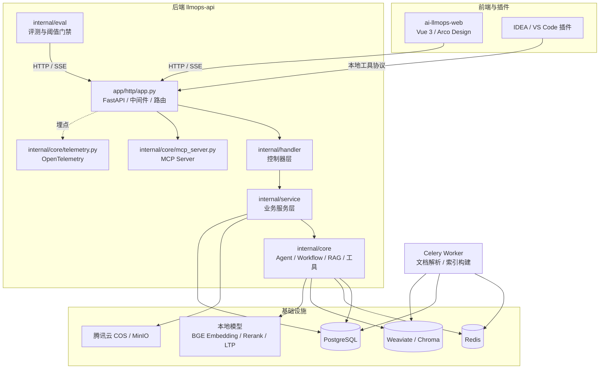

# LLMOps 智能体平台

基于 **FastAPI + LangChain/LangGraph + Vue 3** 的 LLMOps 平台，覆盖 Agent 构建、编排、知识库、工具、记忆、发布与评测。

## 功能

- **Agent 运行时**：ReAct、Function Call、Orchestrator；Postgres Checkpoint 持久化、Redis Stream 事件队列、断点续跑与子任务编排。
- **RAG 知识库**：Dataset / Document / Segment 三级管理，BM25 + 语义检索 + RRF 融合 + Rerank 精排。
- **工作流与工具**：LangGraph 工作流、OpenAPI 工具接入、浏览器自动化、文件系统、PPT 生成与技能隔离执行。
- **模型与内容理解**：多供应商模型接入、本地 Embedding / Rerank、OCR、语音转写与合成、非结构化文档解析。
- **平台能力**：Web 应用发布、开放 API、API Key 管理、运营分析、飞书 Webhook、GitHub OAuth。
- **工程化**：MCP Client / Server、OpenTelemetry 链路与用量指标、JSON / YAML 评测数据集和阈值门禁。

## 技术栈

| 层 | 技术 |
| --- | --- |
| 后端 | Python 3.12 · FastAPI · Uvicorn · SQLAlchemy 2（async） |
| 数据与任务 | PostgreSQL 15 · Redis · Celery · Alembic |
| 向量与检索 | Weaviate · Chroma · sentence-transformers · LTP |
| Agent / LLM | LangChain · LangGraph · 多供应商模型适配 |
| 前端 | Vue 3 · TypeScript · Vite · Pinia · Vue Router · Arco Design |
| 可观测与集成 | OpenTelemetry · LangSmith · MCP |
| 部署 | Docker · Docker Compose · Jenkins |

## 系统架构



后端通过 `MODE` 区分 `api`、`celery`，本地工具场景可使用 `local`；Agent 图状态存放在 Postgres Checkpoint，事件通过 Redis Stream 传递。

## 项目结构

```text
.
├── app/                          # 应用入口
│   └── http/
│       └── app.py                # FastAPI lifespan、中间件、异常处理与路由注册
├── config/                       # 默认配置
├── internal/                     # 后端业务实现
│   ├── config/                   # pydantic-settings 配置
│   ├── core/                     # Agent / RAG / 工具 / 模型核心
│   │   ├── agent/                # ReAct、Function Call、Orchestrator、队列与检查点
│   │   ├── builtin_apps/         # 内置应用
│   │   ├── embeddings/           # 本地 Embedding 与 Rerank 模型
│   │   ├── file_extractor/       # 文件内容提取
│   │   ├── language_model/       # 大模型接入与统一管理
│   │   ├── memory/               # 长期记忆核心
│   │   ├── ocr/                  # OCR 识别
│   │   ├── retrievers/           # BM25 / 语义 / Rerank / RRF 检索
│   │   ├── tools/                # 内置工具、API 工具、MCP Client 与安全执行
│   │   ├── unstructured/         # 非结构化文档解析
│   │   ├── workflow/             # LangGraph 工作流引擎
│   │   ├── mcp_server.py         # MCP Server
│   │   └── telemetry.py          # OpenTelemetry 追踪与指标
│   ├── eval/                     # 评测指标、数据集运行器
│   ├── entity/                   # 领域实体
│   ├── exception/                # 通用异常
│   ├── extensions/               # logging / Redis / Weaviate 初始化
│   ├── handler/                  # 控制器与路由处理器
│   ├── lib/                      # 公共工具库
│   ├── memory/                   # 会话 Token 缓冲记忆
│   ├── middleware/               # 中间件
│   ├── migrations/               # Alembic 迁移
│   ├── model/                    # SQLAlchemy 数据模型
│   ├── router/                   # 路由注册
│   ├── schedule/                 # 定时任务
│   ├── schema/                   # Pydantic 请求 / 响应结构
│   ├── server/                   # 请求上下文与依赖注入
│   ├── service/                  # 业务服务层
│   ├── task/                     # Celery 任务
│   └── container.py              # 依赖容器
├── package/                      # 数据库、OAuth、分页、密码与统一响应
├── templates/                    # PPT 等模板
├── test/                         # pytest 测试
├── scripts/                      # 数据库引导、评测与运维脚本
├── docs/                         # 设计、迁移与接入文档
├── deploy/                       # 部署配置与环境模板
├── docker/                       # Docker 相关配置
├── jenkins/                      # Compose、Nginx、入口脚本与 CI 配置
├── tencentdb_agent_memory/       # 腾讯记忆 SDK（vendored）
├── ai-llmops-web/                # Vue 3 前端
├── idea-plugin/                  # IDEA 插件
├── vscode-plugin/                # VS Code 插件
├── Dockerfile                    # 后端多阶段镜像
├── Jenkinsfile                   # CI/CD 流水线
├── deploy.env                    # 部署参数
├── requirements.in              # Python 直接依赖
├── requirements.lock.txt        # Python 锁定依赖
├── requirements.txt             # Python 运行依赖
└── LICENSE                      # CC0 1.0 Universal
```

## 安装与使用

### 环境要求

- Python 3.12
- Node.js `^20.19.0 || >=22.12.0`，Yarn 4.13
- PostgreSQL 15、Redis、Weaviate；对象存储可使用 MinIO 或腾讯云 COS

### Docker Compose

```bash
cp jenkins/.env.example jenkins/.env
# 修改数据库、Redis、Weaviate、JWT、CONFIG_MASTER_KEY 等配置

docker compose -f jenkins/docker-compose.yaml up -d --build
```

默认 API 端口为 `5001`，Nginx 端口为 `80`。

### 本地开发

先启动 PostgreSQL、Redis 和 Weaviate，再执行：

```bash
python -m venv venv
source venv/bin/activate          # Windows: venv\Scripts\activate
pip install -r requirements.txt

cp deploy/.env.example .env
# 将 .env 中的 db / redis / weaviate 主机改为本地实际地址
# 本地联调使用 5000，与前端 Vite 代理保持一致

python scripts/bootstrap_db.py
uvicorn app.http.app:app --host 0.0.0.0 --port 5000 --reload
```

前端：

```bash
cd ai-llmops-web
corepack enable
yarn install
yarn dev
```

前端开发服务器默认使用 `5173`；生产构建执行 `yarn build`。

### 测试与评测

```bash
pytest

python scripts/eval_suite.py scripts/eval_cases.json \
  --base-url http://127.0.0.1:5000 \
  --output eval-report.json
```

评测配置、指标与阈值说明见 [internal/eval/runner.py](internal/eval/runner.py) 和 [scripts/eval_suite.py](scripts/eval_suite.py)。

## 相关文档

- [docs/](docs/)：设计、迁移、接口与接入文档
- [ai-llmops-web/README.md](ai-llmops-web/README.md)：前端工程说明
- [docs/tencent-memory-integration.md](docs/tencent-memory-integration.md)：腾讯记忆系统接入

## 许可

本仓库原创代码采用 [CC0 1.0 Universal](LICENSE) 发布，可自由复制、修改、分发和商用。

第三方依赖、`tencentdb_agent_memory/` 等 vendored 内容及其自带资源保留各自许可，不在 CC0 覆盖范围内。
