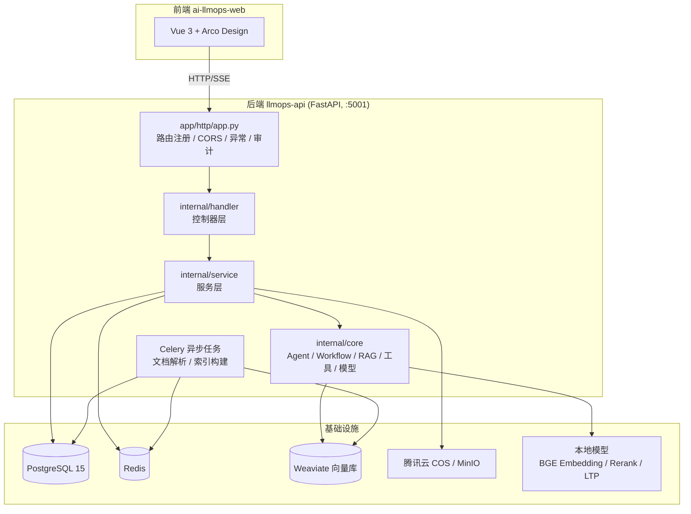

# LLMOps 智能体平台

基于 **FastAPI + LangChain/LangGraph + Vue 3** 的一站式 LLMOps 平台，提供大模型应用（Agent）从构建、编排、知识库管理到发布运营的完整能力：支持多模型接入、RAG 混合检索、智能体编排、工作流、工具集成、技能（Skill）、记忆系统、开放 API 与可视化运营分析。

## 核心特性

- **多模型接入**：DeepSeek / OpenAI / Moonshot / DashScope（通义千问）等主流模型供应商，统一通过 LangChain 接入，支持在线 API 与本地模型。
- **RAG 知识库**：数据集（Dataset）→ 文档（Document）→ 分段（Segment）三级管理，支持多格式文档解析（PDF / Word / PPT / Markdown 等）、本地 Embedding（BGE 系列）或 API Embedding、BM25 全文检索 + 语义检索 + RRF 融合 + Rerank 精排的混合检索链路。
- **智能体（Agent）**：ReAct Agent、Function Call Agent、编排型 Agent（Orchestrator），支持子任务编排与队列管理。
- **工作流（Workflow）**：基于 LangGraph 的可视化工作流编排引擎。
- **工具系统**：内置浏览器自动化（browser-use + Playwright）、文件系统、高德天气、PPT 生成、记忆等工具；支持按 OpenAPI Schema 接入外部 API 工具，并提供内置工具市场与分类管理。
- **技能（Skill）**：可沉淀、复用、分享的智能体技能体系。
- **记忆系统**：会话 Token 缓冲记忆 + 长期记忆（腾讯 TencentDB Agent Memory，支持情景记忆/程序性记忆/用户记忆）。
- **内容理解**：OCR（RapidOCR / DashScope OCR）、中文 NLP（LTP 分词）、语音（ASR 转写 / TTS 合成）、非结构化文档解析（unstructured）。
- **开放能力**：OpenAPI 开放平台、API Key 管理、Web 应用发布（Token 免登录对话）、飞书 Webhook 集成、GitHub OAuth 登录。
- **可观测与安全**：请求审计日志、JWT 认证、权限中间件、统一异常响应契约、LangSmith 链路追踪。

## 技术栈

| 层 | 技术 |
| --- | --- |
| 后端框架 | Python 3.12 · FastAPI · Uvicorn（ASGI） |
| ORM / 数据库 | SQLAlchemy 2.0（async）· asyncpg · PostgreSQL 15 · Alembic 迁移 |
| 缓存 / 队列 | Redis · Celery（异步任务） |
| 向量数据库 | Weaviate · Chroma |
| LLM 生态 | LangChain（core / classic / openai / deepseek / huggingface / weaviate / chroma）· LangGraph |
| 模型推理 | sentence-transformers（BGE 系列 Embedding / Rerank）· transformers · LTP |
| 文档/内容 | unstructured · pypdf · rapidocr_onnxruntime · python-pptx · DashScope |
| 浏览器智能体 | browser-use · Playwright（Chromium） |
| 对象存储 | 腾讯云 COS / MinIO |
| 前端 | Vue 3 · TypeScript · Vite · Pinia · Vue Router · Arco Design · ECharts · Vue Flow |
| 部署 | Docker（多阶段构建）· Docker Compose · Jenkins |

## 系统架构



后端按 `MODE` 环境变量区分运行模式：`api`（API 服务）、`celery`（异步任务 Worker）。

## 项目结构

```
llmops
├── app/                          # 应用入口
│   └── http/
│       └── app.py                # FastAPI 应用：lifespan 装配、CORS、异常处理、路由注册
├── config/                       # 默认配置项
├── internal/                     # 内部实现
│   ├── config/                   # 全局配置（pydantic-settings，读取 .env）
│   ├── core/                     # LLM 核心模块（非业务逻辑）
│   │   ├── agent/                #   Agent 实现：ReAct / Function Call / Orchestrator / 队列
│   │   ├── builtin_apps/         #   内置应用
│   │   ├── embeddings/           #   Embedding 模型（本地 BGE 系列 / API）
│   │   ├── file_extractor/       #   文件内容提取
│   │   ├── language_model/       #   大模型接入与统一管理
│   │   ├── ltp/                  #   LTP 中文 NLP（分词/词性等）
│   │   ├── memory/               #   记忆（长期记忆等）
│   │   ├── ocr/                  #   OCR 识别
│   │   ├── retrievers/           #   检索器：BM25 / 全文 / 语义 / Rerank / RRF
│   │   ├── tools/                #   工具系统：内置工具、API 工具、工具市场
│   │   ├── unstructured/         #   非结构化文档解析（nltk 数据等）
│   │   ├── vector_store/         #   向量库适配
│   │   └── workflow/             #   LangGraph 工作流引擎
│   ├── entity/                   # 领域实体
│   ├── exception/                # 通用异常
│   ├── extensions/               # 扩展：logging / redis / weaviate 初始化
│   ├── handler/                  # 控制器层（路由处理器）
│   ├── lib/                      # 公共工具库
│   ├── memory/                   # 会话记忆（Token 缓冲）
│   ├── middleware/               # 中间件（登录校验等）
│   ├── migrations/               # Alembic 数据库迁移（自动生成）
│   ├── model/                    # SQLAlchemy 数据模型
│   ├── router/                   # 路由注册
│   ├── schedule/                 # 定时任务
│   ├── schema/                   # 请求/响应结构体（Pydantic）
│   ├── server/                   # 服务端依赖（请求上下文 / 会话注入）
│   ├── service/                  # 服务层（业务逻辑）
│   ├── task/                     # Celery 任务（app / dataset / document）
│   └── container.py              # 依赖容器（处理器实例装配）
├── package/                      # 扩展包
│   ├── database/                 #   数据库引擎与会话工厂
│   ├── oauth/                    #   GitHub OAuth
│   ├── paginator/                #   分页器
│   ├── password/                 #   密码工具
│   └── response/                 #   统一响应与 HTTP 状态码
├── storage/                      # 本地存储
├── templates/                    # PPT 等模板文件
├── test/                         # 测试目录（pytest）
├── scripts/                      # 运维/开发脚本
├── jenkins/                      # 部署编排（docker-compose、nginx、入口脚本）
├── tencentdb_agent_memory/       # 腾讯记忆 SDK（vendored，离线可用）
├── ai-llmops-web/           # 前端工程（Vue 3）
├── Dockerfile                    # 后端多阶段镜像
├── Jenkinsfile                   # CI/CD 流水线
├── deploy.env                    # 部署参数（如 INIT_DB）
└── requirements.txt              # Python 依赖
```

## 快速开始

### 环境要求

- Python 3.12
- Node.js ≥ 20.19（前端）
- PostgreSQL 15、Redis、Weaviate（可通过 `jenkins/docker-compose.yaml` 一键拉起）

### 后端启动

```bash
# 1. 安装依赖（建议使用虚拟环境）
python -m venv venv
venv\Scripts\activate            # Windows
# source venv/bin/activate       # Linux/macOS
pip install -r requirements.txt

# 2. 准备配置文件
cp .env.example .env            # 按需修改数据库、Redis、模型 API Key 等

# 3. 启动 API 服务（默认 0.0.0.0:5001，可用 LLMOPS_PORT 覆盖）
uvicorn app.http.app:app --host 0.0.0.0 --port 5001 --reload
```

> 首次启动时，应用会自动执行数据库建表；生产环境建议通过 Alembic 迁移管理 schema：
> `alembic upgrade head`

### 前端启动

```bash
cd ai-llmops-web
yarn            # 安装依赖
yarn dev        # 开发模式，API 请求代理到后端
```

生产构建：`yarn build`，产物输出到 `dist/`。

## 配置说明

项目通过根目录 `.env` 或环境变量注入配置（`internal/config/settings.py`），主要配置项：

| 配置项 | 说明 |
| --- | --- |
| `MODE` | 运行模式：`api` / `celery` / `local` |
| `SQLALCHEMY_DATABASE_URI` | PostgreSQL 连接串 |
| `REDIS_HOST / REDIS_PORT / REDIS_PASSWORD` | Redis（缓存 + Celery broker） |
| `WEAVIATE_HTTP_HOST / WEAVIATE_GRPC_HOST / WEAVIATE_API_KEY` | Weaviate 向量库 |
| `DEEPSEEK_API_KEY / OPENAI_API_KEY / MOONSHOT_API_KEY / DASHSCOPE_API_KEY` | LLM 供应商密钥 |
| `EMBEDDING_PROVIDER / EMBEDDING_MODEL` | Embedding 服务：`local`（本地模型）或 `api` |
| `RERANK_PROVIDER / RERANK_MODEL` | Rerank 精排服务：`local` 或 `api` |
| `QUERY_REWRITE_MODEL` | 查询改写模型（默认 `deepseek-v4-flash`） |
| `STORAGE_PROVIDER` | 文件存储：`cos`（腾讯云）或 `minio` |
| `COS_SECRET_ID / COS_SECRET_KEY / COS_BUCKET / COS_REGION` | 腾讯云 COS 配置 |
| `JWT_SECRET_KEY` | JWT 签名密钥 |
| `GITHUB_CLIENT_ID / GITHUB_CLIENT_SECRET` | GitHub OAuth 登录 |
| `LANGSMITH_API_KEY / LANGSMITH_PROJECT` | LangSmith 链路追踪 |
| `BROWSER_LLM_BASE_URL / BROWSER_LLM_MODEL` | 浏览器智能体的视觉模型（需多模态模型） |
| `GAODE_API_KEY` | 高德天气工具 |

> ⚠️ 生产环境请勿将真实密钥提交到仓库。

## 测试

```bash
# 运行全部测试
pytest

# 运行门禁/慢速测试
PLAN2_GATES=1 pytest -m slow
```

## 部署

### Docker Compose（推荐）

`jenkins/docker-compose.yaml` 编排了完整服务栈：

- `llmops-api`：API 服务（端口 5001）
- `llmops-celery`：Celery 异步任务 Worker
- `llmops-db`：PostgreSQL 15
- `llmops-redis`：Redis 6
- `llmops-weaviate`：Weaviate 1.28 向量库
- `llmops-nginx`：Nginx 反向代理

```bash
IMAGE_NAME=llmops-api IMAGE_TAG=latest docker compose -f jenkins/docker-compose.yaml up -d --build
```

### Jenkins CI/CD

`Jenkinsfile` 定义流水线：Checkout → 构建 Docker 镜像 → 通过 Compose 滚动部署（`deploy.env` 中 `INIT_DB=true` 时初始化数据库）→ 清理镜像。

### 数据库迁移

```bash
alembic upgrade head    # 升级到最新版本
alembic revision --autogenerate -m "描述"   # 生成新迁移
```

## 腾讯记忆系统（TencentDB Agent Memory）

本平台长期记忆可接入腾讯记忆系统（`TencentCloud/TencentDB-Agent-Memory` v2.0.1）。记忆服务组件（MemoryCore 等）为**外部依赖**，部署时从官方仓库克隆或使用 Docker Hub 公开镜像（`agentmemory/*`）；Python SDK 已 vendor 至仓库根 `tencentdb_agent_memory/`（离线可用，唯一外部依赖 `httpx` 已写入 `requirements.txt`）。

### 组件与部署文件（官方仓库）

| 组件 | 官方仓库路径 | 默认端口 | 用途 |
| --- | --- | --- | --- |
| MemoryCore | `MemoryCore/` | 8420 | 记忆读写 Gateway，运行 L0→L3 记忆流水线 |
| MemoryPanel | `MemoryPanel/` | 8125 | 团队记忆管理面板（Web UI） |
| MemoryKnowledge | `MemoryKnowledge/` | 8424 | Wiki / Code-Graph 知识服务 |
| MemoryProxy | `MemoryProxy/` | 8096 | LLM 请求代理（Anthropic / OpenAI 双协议） |
| 一键部署脚本 | `deploy/global-images/` | — | `start-all.sh` 等，Docker 镜像一键拉起三件套 |
| SDK | `sdk/`（Python / TypeScript） | — | 官方 SDK 源码 |
| Agent 适配 | `agents/` | — | Claude Code / CodeBuddy / Codex / DSH / OpenCode 等接入配置 |

### 本地部署方式

**方式一：Docker 镜像一键三件套（推荐）**

```bash
git clone --depth 1 https://github.com/TencentCloud/TencentDB-Agent-Memory.git
cd TencentDB-Agent-Memory/deploy/global-images
cp .env.example .env          # 填写 MEMORY_*（记忆/知识内部 LLM）与 PROXY_*（代理上游 LLM）两组参数
./start-all.sh                # 交互式启动：自动检查 LLM 通路并拉起 memory-core / memory-hub / proxy
./stop-all.sh                 # 停止
./verify.sh                   # 干跑校验（--skip-llm 跳过 LLM 检查）
```

启动后 admin `user_key` 自动生成并持久化在 `./.admin-key`，管理面板地址 <http://localhost:8125>。想强制拉取最新镜像用 `PULL=1 ./start-all.sh`。

**方式二：源码启动 MemoryCore（Standalone 单机）**

```bash
git clone --depth 1 https://github.com/TencentCloud/TencentDB-Agent-Memory.git
cd TencentDB-Agent-Memory/MemoryCore
npm install
export TDAI_LLM_API_KEY="sk-xxx"
export TDAI_LLM_BASE_URL="https://api.deepseek.com/v1"
export TDAI_LLM_MODEL="deepseek-v4-flash"
npx tsx src/gateway/server.ts    # 默认监听 http://127.0.0.1:8420
```

数据存储在 `~/.memory-tencentdb/memory-tdai/`（SQLite + 本地文件）；YAML 配置参考 `MemoryCore/tdai-gateway.yaml` / `tdai-gateway.standalone.yaml`。

**方式三：Docker 单容器 Gateway**

```bash
docker run -d \
  -e TDAI_LLM_API_KEY="sk-xxx" \
  -e TDAI_LLM_BASE_URL="https://api.deepseek.com/v1" \
  -e TDAI_LLM_MODEL="deepseek-v4-flash" \
  -e TDAI_GATEWAY_HOST="0.0.0.0" \
  -p 8420:8420 \
  -v tdai-data:/root/.memory-tencentdb/memory-tdai \
  agentmemory/hermes-memory:latest
```

> 生产级多租户部署（Service 模式：TCVDB + COS + Redis、K8s 多副本）参见官方仓库 `README.deployment.md`。

### 与 LLMOps 平台集成

在**系统设置 → 记忆系统**中选择 `tencent`，并配置三个系统配置项（API Key 加密入库、GET 脱敏回显）：

| 配置键 | 说明 | 示例 |
| --- | --- | --- |
| `TENCENT_MEMORY_ENDPOINT` | Memory Core 服务地址 | `http://127.0.0.1:8420` |
| `TENCENT_MEMORY_API_KEY` | Memory 实例 Bearer token | `sk-mem-...` |
| `TENCENT_MEMORY_SERVICE_ID` | 记忆空间/实例 ID | `default` |

代码接入点：

- SDK：仓库根 `tencentdb_agent_memory/` —— 默认导出 v2 `MemoryClient(endpoint, api_key, service_id)`；显式 `from tencentdb_agent_memory.v3 import MemoryClient` 切换到 v3 严格隔离版本（team/agent/user 必填）。
- Provider 抽象层：`internal/service/memory_provider/`（`base.py` / `builtin_provider.py` / `tencent_provider.py` / `tencent_client.py` / `resolver.py`），SDK 懒加载，服务不可用时自动回退为无记忆。

### 参考文档

- 官方仓库 `INSTALL_CN.md`：三件套安装指南（含 Panel 建 Team / Agent / Task 步骤）
- 官方仓库 `README_CN.md`：主 README
- 官方仓库 `README.deployment.md`：两种部署形态（Standalone / Service）+ v1/v2 API 概览
- 官方仓库 `README.docker.md`：Docker 部署说明
- 官方仓库 `deploy/global-images/README.md`：一键部署脚本说明
- `docs/tencent-memory-integration.md`：本平台的腾讯记忆接入说明

## 相关文档

- `docs/`：设计文档、迁移报告、接口清单等
- `ai-llmops-web/README.md`：前端工程说明
